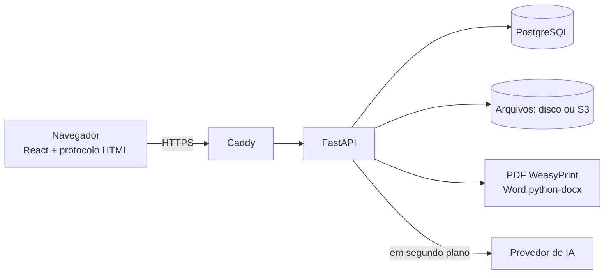
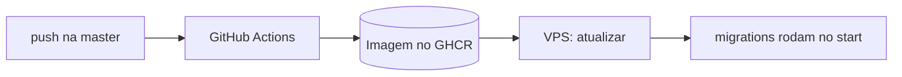

# Sistema de Relatório Automático para Psicólogos

Plataforma web que transforma o protocolo de avaliação neuropsicopedagógica da Mayra em um relatório pronto,
no padrão dela, em PDF e Word.

## Sumário

1. [O que é o sistema](#1-o-que-é-o-sistema)
2. [O que ele faz](#2-o-que-ele-faz)
3. [Como funciona por dentro](#3-como-funciona-por-dentro)
4. [Fluxo de uso](#4-fluxo-de-uso)
5. [Estrutura de pastas](#5-estrutura-de-pastas)
6. [Tecnologias](#6-tecnologias)
7. [Rodar localmente](#7-rodar-localmente)
8. [Testes](#8-testes)
9. [Deploy](#9-deploy)
10. [Backup e restauração](#10-backup-e-restauração)
11. [Segurança e LGPD](#11-segurança-e-lgpd)
12. [Problemas comuns](#12-problemas-comuns)
13. [Histórico do projeto](#13-histórico-do-projeto)

## 1. O que é o sistema

Uma ferramenta para psicólogas e neuropsicopedagogas. Em vez de aplicar escalas, somar pontos e escrever o
laudo à mão, a profissional preenche o protocolo no sistema (ou envia os PDFs dos formulários e deixa a IA ler),
e o sistema calcula, monta o relatório, gera os gráficos e exporta em PDF e Word. Cada profissional só vê os
próprios pacientes.

## 2. O que ele faz

* Login individual por psicóloga; cada conta enxerga só os próprios dados.
* Cadastro de pacientes, com fotos.
* **Novo Atendimento:** o protocolo completo (identificação, histórico, escola, escalas CARS, ATA, SNAP-IV, TOD, M-CHAT e Portage) com cálculo automático e salvamento automático.
* **Laudo por IA:** lê PDFs de formulários e escalas, preenche o protocolo e redige o estudo de caso.
* Pendências: mostra o que ficou sem resposta e deixa completar digitando ou anexando foto/documento.
* Relatório final no padrão da Mayra, com capa, tabelas, gráficos e assinatura, em PDF e em Word editável.
* Modelos de protocolo próprios, cadastrados em Configurações.
* Capa personalizável, registro profissional e credenciais da assinatura.
* Histórico do paciente e registro de atividades (quem mudou o quê).
* Formulários preenchidos pelos responsáveis (registro, validação).
* Configuração da IA por psicóloga (provedor, modelo, chave guardada criptografada).

## 3. Como funciona por dentro



O protocolo roda no navegador e monta o relatório em HTML. O servidor guarda o HTML e o converte em PDF e Word.
Detalhes, fluxo da IA e modelo de dados: [docs/ARQUITETURA.md](docs/ARQUITETURA.md).

## 4. Fluxo de uso

**Caminho 1: Novo Atendimento**

1. Cadastrar o paciente (ou escolher um existente).
2. Pacientes > Novo Atendimento; preencher o protocolo (cada campo salva sozinho).
3. Conferir a pontuação e os textos; escolher hipóteses e encaminhamentos.
4. "Salvar no sistema" e baixar o PDF ou o Word pelo Histórico.

**Caminho 2: Laudo por IA**

1. Pacientes > Laudo por IA; escolher o paciente e enviar os PDFs.
2. Acompanhar a barra de progresso (leva alguns minutos).
3. Abrir o quadro "Há alguns campos que podem ser preenchidos"; completar ou anexar documentos.
4. "Atualizar relatório", conferir a prévia e baixar PDF ou Word.

## 5. Estrutura de pastas

```
psicologa/
├── backend/
│   ├── app/
│   │   ├── api/          rotas da API
│   │   ├── core/         configuração, segurança, erros, limites
│   │   ├── models/       tabelas do banco
│   │   ├── schemas/      formatos de entrada e saída
│   │   ├── services/     PDF/Word, Laudo por IA, pendências, storage
│   │   │   └── ai/       provedores, prompts e agentes de IA
│   │   └── rules_engine/ motor de regras antigo (legado)
│   ├── alembic/          migrations do banco
│   ├── scripts/          backup só do banco
│   └── tests/            testes do backend
├── frontend/
│   ├── public/           protocolo padrão (HTML), fontes, imagens, Chart.js
│   └── src/
│       ├── pages/        telas
│       ├── components/   componentes (ds/ = design system)
│       ├── api/          chamadas à API
│       └── laudo/        montagem do relatório no navegador
├── scripts/              atualizar, backup e gerar .env (para a VPS)
├── docs/                 ESCOPO, ARQUITETURA, REGRAS_DO_RELATORIO, MANUTENCAO
├── .github/workflows/    publicação da imagem Docker
├── Dockerfile, docker-compose*.yml, Caddyfile
└── CLAUDE.md, SPEC.md, PROMPTS.md, ENTREGAS.md, APRESENTACAO.md, DEPLOY.md   documentos de projeto
```

## 6. Tecnologias

| Parte | Tecnologia (versão) |
|---|---|
| Backend | Python 3.12 na imagem; FastAPI 0.142, SQLAlchemy 2.0, Alembic 1.13, Pydantic 2.13 |
| PDF e gráficos | WeasyPrint 70, Matplotlib 3.11, Chart.js (no navegador) |
| Word | python-docx 1.1 |
| IA | LangChain 1.4 (Claude, GPT, Gemini e outros) |
| Banco | PostgreSQL 16 (produção), SQLite (desenvolvimento e testes) |
| Frontend | React 19, Vite 8, TypeScript 6, React Router 7 |
| Testes | pytest 9 (backend), Vitest 5 (frontend) |
| Qualidade | ruff (backend, `backend/pyproject.toml`), oxlint (frontend) |
| Entrega | Docker (build em Node 20, execução em Python 3.12), GitHub Actions, GHCR, Caddy |

## 7. Rodar localmente

**Pré-requisitos:** Python 3.12 ou mais novo, Node 20 ou mais novo. Para PDFs no Windows, o WeasyPrint precisa do
GTK (Linux e Docker já trazem as bibliotecas).

**Variáveis de ambiente.** O backend lê `backend/.env` (ou variáveis do sistema). Sem nada, usa SQLite
(`backend/dev.db`) e a chave de desenvolvimento. Exemplo (valores fictícios):

```bash
DATABASE_URL=sqlite:///./dev.db
JWT_SECRET=<SEU_SEGREDO_LONGO>
ADMIN_NAME=<NOME>
ADMIN_EMAIL=<SEU_EMAIL>
ADMIN_PASSWORD=<SENHA_COM_8_A_72_CARACTERES>
```

Todas as variáveis (IA, S3, cadastro público…) estão em [.env.example](.env.example).

**Sem Docker:**

```bash
cd backend
python -m venv .venv && . .venv/bin/activate      # no Windows: .venv\Scripts\activate
pip install -r requirements.txt
python -m alembic upgrade head                     # cria as tabelas
python -m app.seed_admin                           # cria a conta de ADMIN_EMAIL / ADMIN_PASSWORD
python -m uvicorn app.main:app --reload            # API em http://localhost:8000

# em outro terminal, para ver as telas:
cd frontend && npm install && npm run dev          # http://localhost:5173 (proxy para o backend)
# ou: npm run build, e o backend serve frontend/dist na própria porta 8000
```

**Primeiro usuário:** defina `ADMIN_EMAIL` e `ADMIN_PASSWORD` e rode `python -m app.seed_admin`. Em
desenvolvimento também dá para criar conta por `POST /api/auth/register` (desligado em produção).

**Com Docker (produção local):** `cp .env.example .env`, preencha, e `docker compose up -d --build`
(sobe banco, app e Caddy; o domínio precisa apontar para a máquina). Depois de editar o
`formulario-novo-paciente.html`, rebuilde o frontend.

## 8. Testes

```bash
cd backend && python -m pytest          # cerca de 360 testes
cd frontend && npx vitest run           # 95 testes
cd frontend && npx tsc -b && npx oxlint # tipos e lint
cd backend && python -m ruff check . && python -m ruff format --check .
```

Cobrem: login e isolamento entre contas, pacientes, laudos, motor de regras, PDF e Word (inclusive gráficos
reais), Laudo por IA com IA simulada, pendências, anexos, segurança (cabeçalhos, path traversal, URLs externas),
criptografia, e no frontend o protocolo padrão (documento, hipóteses, gráficos) e as telas principais. A IA real
nunca é chamada nos testes.

## 9. Deploy



1. Subir o código para a `master` (`.github/workflows/` constrói e publica `ghcr.io/<dono>/<repo>:latest` e `:sha-<commit>`).
2. Na VPS, atualizar: `./scripts/atualizar.sh` (faz backup, `git pull`, rebuild e confere `/api/health`), ou "Pull and redeploy" na stack do Portainer.
3. As migrations rodam sozinhas ao iniciar o container.
4. Para **voltar à versão anterior**: use a etiqueta `sha-<commit anterior>` (variável `APP_IMAGE` no Portainer) ou `git checkout` do commit anterior e `docker compose up -d --build`. Veja os cuidados com migrations em [docs/MANUTENCAO.md](docs/MANUTENCAO.md).

Instalação inicial: [DEPLOY.md](DEPLOY.md).

## 10. Backup e restauração

`./scripts/backup.sh` salva o banco e os arquivos (fotos, PDFs, capas) em `./backups`, mantendo os 14 últimos.
Agende diariamente e copie para fora da VPS. Passo a passo da restauração: [docs/MANUTENCAO.md](docs/MANUTENCAO.md).

## 11. Segurança e LGPD

* Dados de saúde, inclusive de crianças: tratar como sensíveis.
* Toda rota de dados exige login e filtra por dono; senhas com bcrypt; chave de IA criptografada.
* Em produção: `JWT_SECRET` forte obrigatório, cadastro público e `/docs` desligados, cabeçalhos de segurança, container sem root, imagem sem segredos.
* PDFs gerados nunca buscam arquivos do servidor nem endereços externos.
* **Cuidados para quem mexer:** nunca colocar dados reais de pacientes em testes, comentários ou documentos (use nomes fictícios); não registrar dados de pacientes em logs; não renomear tabelas, rotas, variáveis nem pastas de arquivos; não rodar `docker volume prune` (ver [docs/MANUTENCAO.md](docs/MANUTENCAO.md)).

## 12. Problemas comuns

| Sintoma | Causa provável | Solução |
|---|---|---|
| App não sobe em produção reclamando do `JWT_SECRET` | Segredo fraco ou de exemplo | Gerar com `openssl rand -hex 32` |
| Não consigo criar conta | Cadastro público desligado em produção | Usar `ADMIN_EMAIL`/`ADMIN_PASSWORD` e reiniciar |
| Depois de mudar o `JWT_SECRET`, a IA para de funcionar | A chave de IA foi criptografada com o segredo antigo | Cadastrar a chave de novo em Configurações > IA |
| Mudei o `formulario-novo-paciente.html` e nada mudou | Frontend não foi recompilado ou o navegador guardou cache | `npm run build` e recarregar sem cache |
| Laudo por IA para com "limite de uso" ou "cota diária" | Limite do provedor de IA | Esperar, ou trocar de modelo/provedor |
| "A geração foi interrompida" | O servidor reiniciou durante a geração | Gerar de novo; PDFs já lidos não são lidos outra vez |
| PDF não gera no Windows | Falta o GTK do WeasyPrint | Instalar o GTK ou usar Docker |
| Relatório antigo não mostra as mudanças novas | Relatórios salvos só mudam ao atualizar | Clicar em "Atualizar relatório" |
| Porta 8000 ocupada | Outro programa | `uvicorn ... --port 8010` e `BACKEND_PORT=8010` no frontend |

## 13. Histórico do projeto

O sistema nasceu em setembro de 2026 e passou por uma mudança de rumo em 20/09 (protocolo fixo no lugar de
modelos configuráveis). Resumo em [docs/ESCOPO.md](docs/ESCOPO.md) (o que foi combinado, entregue e pendente) e
[CHANGELOG.md](CHANGELOG.md) (por data). Outros documentos: [docs/REGRAS_DO_RELATORIO.md](docs/REGRAS_DO_RELATORIO.md),
[docs/MANUTENCAO.md](docs/MANUTENCAO.md), [SPEC.md](SPEC.md) e [ENTREGAS.md](ENTREGAS.md) (diários antigos, parte
do conteúdo descreve o motor de regras abandonado).
