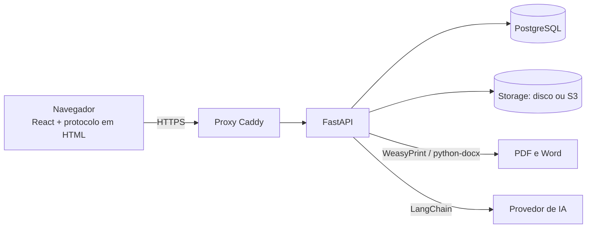
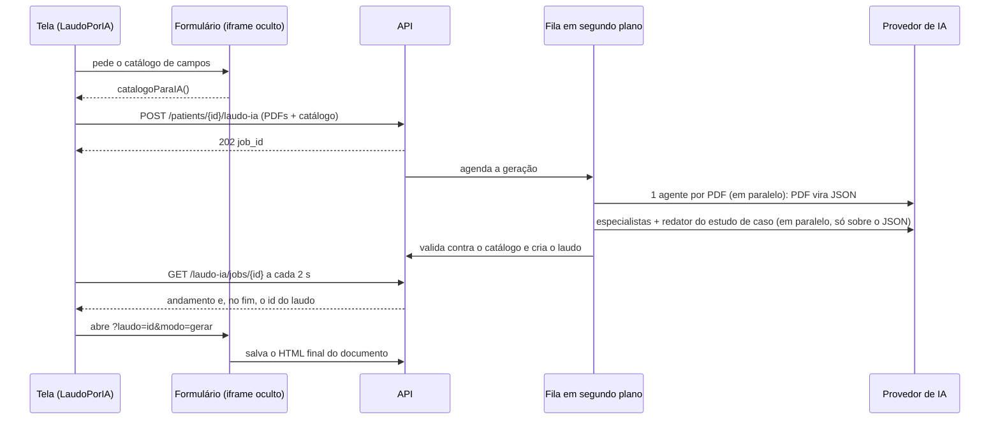
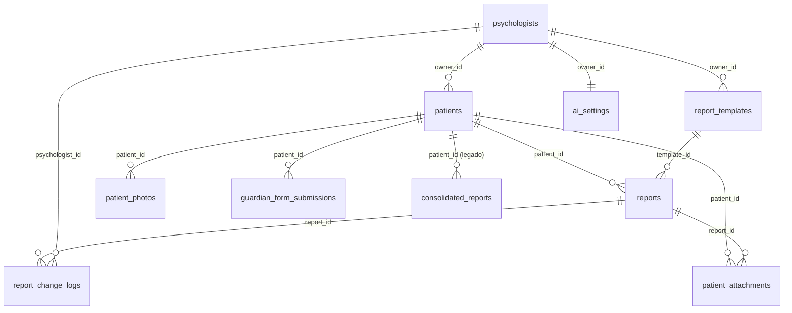

# Arquitetura

## Sumário

* [Visão geral](#visão-geral)
* [Módulos e como conversam](#módulos-e-como-conversam)
* [Modelo de dados](#modelo-de-dados)
* [Onde ficam os arquivos (storage)](#onde-ficam-os-arquivos-storage)
* [Rotas da API](#rotas-da-api)
* [Decisões técnicas e motivos](#decisões-técnicas-e-motivos)
* [Glossário](#glossário)

## Visão geral

Um único serviço em produção: o FastAPI responde a API (`/api/...`) e entrega o frontend já compilado
(`frontend/dist`). O Node.js só existe durante o build da imagem.

O **protocolo padrão** (`frontend/public/formulario-novo-paciente.html`) roda inteiro no navegador: pontua as
escalas, interpreta, e monta o HTML do relatório. O backend guarda esse HTML e o converte em PDF/Word.

## Módulos e como conversam

| Módulo | Pasta | O que faz |
|---|---|---|
| API | `backend/app/api/` | Rotas; sempre filtram por psicóloga logada |
| Núcleo | `backend/app/core/` | Config, JWT, bcrypt, criptografia, limite de login, cabeçalhos, erros, upload |
| Modelos | `backend/app/models/` | Tabelas |
| Schemas | `backend/app/schemas/` | Formatos de entrada/saída |
| Exportação | `services/laudo_documento.py`, `services/pdf_do_laudo.py` | HTML → PDF e Word; PDF em cache |
| Laudo por IA | `services/laudo_ia.py`, `laudo_ia_jobs.py`, `ata.py`, `pendencias.py` | Geração em segundo plano, pontuação da ATA, pendências |
| IA | `services/ai/` | Provedores, prompts, agentes (extração, especialistas, anexos) |
| Storage | `services/storage.py` | Disco local ou S3, pelas mesmas funções |
| Motor de regras (legado) | `backend/app/rules_engine/` | Pontuação dos modelos configuráveis antigos |
| Telas | `frontend/src/pages`, `components` | React |
| Relatório no navegador | `frontend/src/laudo/` | Monta o documento dos modelos próprios e do relatório por PDFs |

### Fluxo do Laudo por IA

## Modelo de dados

| Tabela | Conteúdo importante |
|---|---|
| `psychologists` | Conta, hash da senha, registro (CRP), textos da assinatura, capa padrão |
| `patients` | Nome, nascimento, escola, `dados_complementares` (JSON com o que a psicóloga confirmou) |
| `reports` | `answers_json` (respostas), `computed_json` (pontuação, catálogo, estudo de caso da IA), `generated_text` (HTML final), `pdf_path` |
| `report_templates` | `schema_json` com `rule_type`: `custom_form` (protocolo padrão, "porta-laudo"), `protocolo` (modelo próprio), `relatorio_ia_pdf` (relatório por PDFs antigo) ou os tipos do motor antigo |
| `report_change_logs` | Registro de atividades (quem mudou qual campo) |
| `ai_settings` | Provedor, modelo e chave **criptografada** |
| `patient_photos`, `patient_attachments` | Galeria e anexos para completar pendências |
| `guardian_form_submissions` | Formulários dos responsáveis |
| `consolidated_reports` | Legado, sem uso novo |

Migrations: `backend/alembic/versions/` (12). Rodam sozinhas no start do container.

## Onde ficam os arquivos (storage)

`backend/storage/<pasta>/` no disco (volume `app_storage` na VPS) ou prefixo `<pasta>/` no bucket S3.

| Pasta | Conteúdo |
|---|---|
| `photos` | Fotos da galeria do paciente |
| `covers` | Capa padrão de cada psicóloga |
| `form_pdfs` | PDFs enviados ao Laudo por IA, cache das leituras (`extracoes/`) e andamento das gerações (`laudo_ia_jobs/`) |
| `reports` | PDFs gerados em cache |
| `anexos` | Fotos e documentos das pendências |
| `guardian_forms` | Originais dos formulários dos responsáveis |

**Não renomeie nada disso:** os caminhos estão gravados no banco e nos volumes.

## Rotas da API

74 rotas, agrupadas (lista completa: rodar localmente e abrir `/docs`, que só existe fora de produção).

| Grupo | Prefixo | Arquivo |
|---|---|---|
| Conta e capa | `/api/auth` | `api/auth.py` |
| Pacientes e fotos | `/api/patients` | `api/patients.py` |
| Laudos | `/api/patients/{id}/reports`, `/api/reports/{id}...` | `api/reports.py` |
| Laudo por IA | `/api/patients/{id}/laudo-ia`, `/api/laudo-ia/jobs/{id}`, `/escalas-de-pdf` | `api/laudo_ia.py` |
| Pendências | `/api/reports/{id}/pendencias`, `/atualizar`, `/metodos-excluidos`, `/api/patients/{id}/dados-complementares` | `api/pendencias.py` |
| Anexos | `/api/patients/{id}/anexos` | `api/anexos.py` |
| Relatório por PDFs (antigo) | `/api/patients/{id}/relatorios-pdf` | `api/relatorios_pdf.py` |
| Protocolos próprios | `/api/protocolos` | `api/protocolos.py` |
| Modelos (motor antigo e porta-laudo) | `/api/templates` | `api/templates.py` |
| PDF e Word | `/api/documents/{pdf,docx}`, `/api/reports/{id}/{pdf,docx}` | `api/documents.py`, `api/reports.py` |
| Responsáveis | `/api/patients/{id}/guardian-forms` | `api/guardian_forms.py` |
| IA | `/api/settings/ai` | `api/ai_settings.py` |
| Painel e saúde | `/api/stats/summary`, `/api/health` | `api/stats.py`, `main.py` |

## Decisões técnicas e motivos

| Decisão | Motivo |
|---|---|
| Um serviço só (API + frontend estático) | Custo e simplicidade para um projeto pequeno; um container, uma porta |
| Protocolo fixo em HTML único, em vez de modelos configuráveis | A Mayra já validava esse formulário; reescrever as escalas gerou risco. Decisão de 20/09 |
| Pontuação e texto no navegador; backend só guarda e converte | Preserva a lógica clínica original sem reescrita |
| Relatório como HTML, convertido em PDF (WeasyPrint) e Word (python-docx) | Um só documento-fonte para as duas saídas; o Word segue um vocabulário fechado de classes CSS |
| Modelos próprios copiam o visual em `src/laudo/` | Não mexer no protocolo padrão; custo: mudar o visual exige replicar |
| IA sempre no servidor, chave criptografada (Fernet derivada do `JWT_SECRET`) | A chave nunca vai ao navegador. Trocar o `JWT_SECRET` obriga a cadastrar a chave de novo |
| IA só devolve conteúdo estruturado; o documento é montado pelo sistema | Controle do layout e dos textos obrigatórios |
| ATA pontuada pelo sistema, não pela IA | A regra é fixa e precisa ser igual em todo laudo |
| Pendências calculadas pelo sistema | Previsível e sem custo de IA |
| Geração do Laudo por IA em thread do processo, andamento em JSON no storage | Sem fila externa nem tabela nova; visível aos 2 processos do servidor |
| Cache da leitura dos PDFs por hash do arquivo | Reenviar o mesmo PDF não chama a IA (suba `VERSAO_DA_EXTRACAO` ao mudar o prompt) |
| Listas devolvem só o resumo do laudo | Um laudo completo passa de 1 MB (fotos e HTML) |
| Storage por "chave lógica" (disco ou S3) | Troca de armazenamento sem mexer no código |
| Limite de login em memória | Simples; com 2 processos o limite real pode chegar a o dobro |
| Contêiner sem root, CSP só `'self'`, sem CDN | Dados de saúde (LGPD) |
| Banco: PostgreSQL em produção, SQLite em dev e testes | Facilidade local |

## Glossário

| Termo | Significa |
|---|---|
| Laudo = Relatório | O documento final. O código diz `report`/`laudo`; as telas dizem "Relatório" |
| Protocolo padrão | O formulário HTML fixo da Mayra (`rule_type: custom_form`) |
| Modelo de protocolo próprio | Formulário cadastrado em Configurações (`rule_type: protocolo`) |
| Porta-laudo | O `ReportTemplate` técnico que os laudos do protocolo padrão apontam |
| Laudo por IA | Fluxo que lê PDFs e preenche o protocolo (rota `/laudo-ia`; `/relatorio-ia` redireciona) |
| Relatório por PDFs | Fluxo antigo da IA (`relatorio_ia_pdf`), ainda aberto pelo Histórico |
| Pendências | Campos que ficaram sem resposta |
| Catálogo | Lista de campos do formulário que a IA pode preencher |
